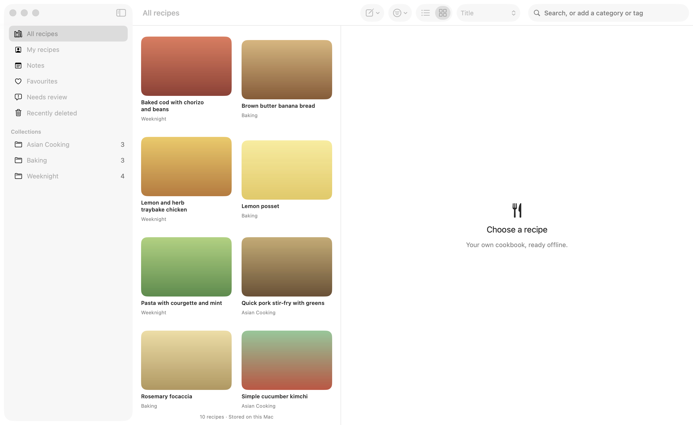
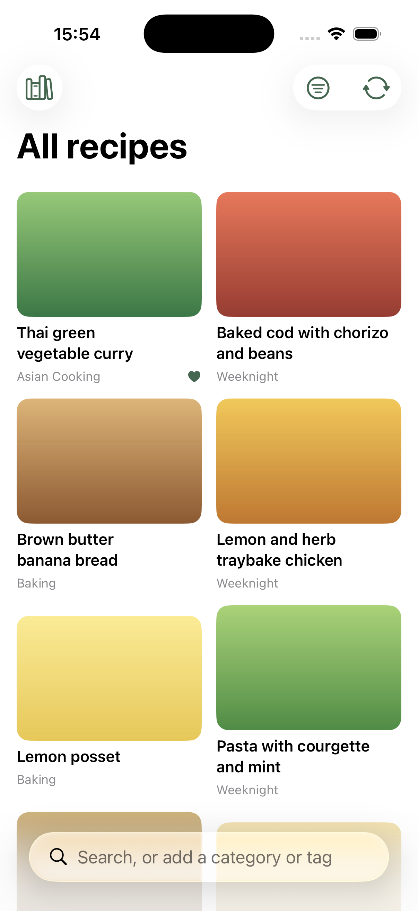
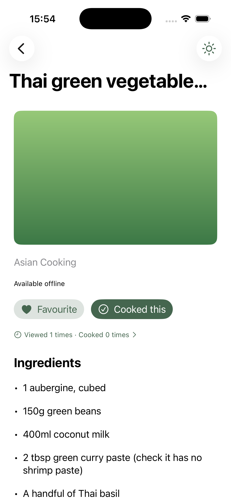

# Recipe App

A personal, offline recipe library for Mac, iPhone and iPad, written in Swift and SwiftUI. I built it to replace Evernote for about 850 recipes I had collected over the years: no subscription, no server, no cloud account, and it all still works with the Wi-Fi off.

This repository is a cleaned-up showcase copy of the app. My own library is not included, so import your own Markdown recipes to try it.

| Mac | iPhone |
| --- | --- |
|  |   |

## What it does

- **Imports Markdown exports** (for example Evernote via [Yarle](https://github.com/akosbalasko/yarle)), copying local images and PDFs into the app's own library. The source files are never modified.
- **Catalogues recipes** with categories, cuisine, main ingredient, ingredients and tags from fixed lists, read from `.catalogue.json` sidecar files beside each recipe.
- **Searches** text, ingredients (with synonyms, so "cilantro" finds coriander) and catalogue fields, with a small query syntax: `#weeknight`, `category:asian`, `cuisine:thai`, `cooked:never`, `cooked:>6m`, `"exact phrase"` and `-word` to exclude.
- **Tracks cooking:** favourites, view counts, cooked dates with photos, personal notes, and a cooking mode that keeps the screen on.
- **Edits recipes** on the Mac, including photos, while always keeping the original imported Markdown for reference.
- **Finds duplicates** on import (exact copies are skipped; near matches go to a review screen).
- **Syncs Mac and iPhone over the local network** (Bonjour), with no server. The Mac owns recipe content; favourites, cooked dates and views merge both ways.
- **Backs up** to a portable folder of Markdown and images, with hash checks on restore.

## The pieces

| Path | What it is |
| --- | --- |
| `Sources/RecipeCore` | Shared Swift library: model, Core Data persistence and migrations, importer, search, catalogue, images, backup, sync |
| `Sources/RecipeMac` | The Mac app (SwiftUI): import, browse, search, edit, record cooking |
| `iOS-App/` | The iPhone and iPad app (SwiftUI, Xcode project): browse, search and cook offline |
| `Tests/RecipeCoreTests` | 80 XCTest tests, all run against temporary libraries |

See [ARCHITECTURE.md](ARCHITECTURE.md) for the design decisions.

## Running it

Requirements: a Mac with a recent Xcode (developed with Xcode 26). The apps target macOS 13 and iOS/iPadOS 15. There are no third-party Swift packages.

**Tests**

```sh
swift test
Scripts/check-ios.sh    # compiles and links the shared code and iPhone app for iOS 15
```

**Mac app**, on a disposable library so nothing touches a real one:

```sh
Scripts/run-feature-preview.sh
```

Then choose **Import** and select a folder of Markdown recipes. Or open `Package.swift` in Xcode and run the **RecipeApp** scheme with the environment variable `RECIPEAPP_LIBRARY_PATH` pointing at a scratch folder. `Scripts/build-mac.sh` builds an ad-hoc signed `.app` bundle.

**iPhone app:** open `iOS-App/RecipeApp.xcodeproj`, choose the **RecipeMobile** scheme and an iPhone simulator, and run. A Debug build adds a few sample recipes on first launch; otherwise the iPhone gets its recipes by syncing with the Mac app (the Sync button on each side).

## How it was built

I am a technology leader rather than a Swift developer. I designed the app, set the rules and reviewed the changes, and the code was written with AI coding assistants: OpenAI Codex first, then Claude Code. The constraints I set, which you can see throughout the code:

- **Offline first.** Views read only the local store; there are no network calls from views and no remote image fetching.
- **Never touch the source data.** The importer copies; it refuses to write inside the source export.
- **Files, not blobs.** Images and PDFs are stored as files with relative paths, never inside the database.
- **Old devices matter.** Core Data rather than SwiftData, so the app still runs on an iPad stuck on iPadOS 15.
- **Every schema change has a backed-up migration and a test.**
- **No paid APIs.** Cataloguing the recipes was done by the coding assistant reading batches and writing sidecar files, checked by a validator, not by calling a pay-per-use model API.

## Licence

[MIT](LICENSE).
